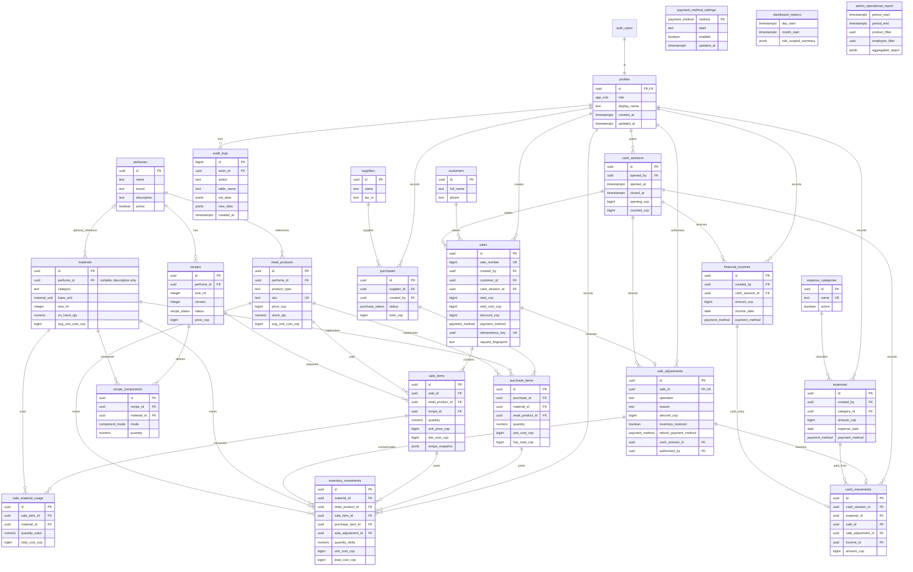

# Modelo entidad-relación — Perfumeria SC

Este documento describe el modelo relacional inicial de Supabase PostgreSQL.
Las cantidades son `NUMERIC`; los importes expresados en COP son enteros. Las
recetas guardan cantidades en la unidad base de cada material y nunca convierten
entre gramos y mililitros.



## Relaciones y reglas de dominio

- `profiles.id` referencia uno a uno `auth.users.id`; el rol no se toma de
  `user_metadata` ni puede ser autoseleccionado por un usuario.
- `perfumes` es el catálogo de referencias olfativas; una referencia no crea
  producto terminado ni existencias. `retail_products` guarda originales y 1.1
  comercializables; las recetas se asocian a una referencia y presentación.
- `materials` representa insumos. Su `perfume_id` es opcional y descriptivo:
  no determina qué receta consume el material. `recipe_components` es la
  relación operativa; una misma esencia y su existencia/costo se reutilizan
  entre recetas sin duplicar el material.
- Una receta tiene versiones `draft`, `active` o `archived`; solo puede haber
  una versión activa por perfume y tamaño. Para modificar una receta activa se
  crea una versión borrador, se editan sus componentes y se activa mediante
  función transaccional.
- Un componente `fixed` tiene cantidad positiva en la unidad base del material.
  Como máximo un componente puede ser `fill_to_volume` por receta; debe usar
  material `ml` y su cantidad se calcula al vender como tamaño de la receta
  menos los componentes fijos que también usan `ml`. Una cantidad no positiva
  invalida la operación. No se convierte g a ml ni se infiere una receta.
- `materials` y `retail_products` conservan existencias y costo promedio
  ponderado en COP/unidad, con redondeo explícito a COP entero. Las entradas y
  salidas se registran en `inventory_movements`; no se permiten ajustes de
  inventario sin una función transaccional autorizada.
- Cada línea de venta referencia producto terminado **o** receta (exclusivo).
  Copia nombre, presentación, precio, costo y, cuando aplica, versión y
  componentes de receta. `sale_material_usage` conserva el consumo efectivo y
  el costo de cada material. Cambios futuros no alteran la venta histórica.
- `register_pos_sale` liga cada solicitud a una clave idempotente y una huella,
  bloquea existencias concurrentes y confirma encabezado, líneas, snapshots,
  consumo, movimientos y caja en una transacción. `sale_adjustments` conserva
  anulaciones/devoluciones totales y sus movimientos compensatorios; las ventas
  no se eliminan físicamente.
- `payment_method_settings` configura etiquetas y disponibilidad de los tipos
  definidos por `payment_method`; agregar un tipo requiere migrar el enum.
- El empleado puede consultar sus ventas y registrar ventas; sus permisos SQL
  no incluyen columnas de costos, márgenes ni utilidades. `recipe_components`,
  inventario operativo y ajustes de sus propias ventas son de solo lectura;
  costos, compras, gastos, configuración y auditoría quedan restringidos al
  administrador. El empleado solo puede consultar componentes de recetas
  activas.
- `purchases`/`purchase_items` se preparan como borrador y una función registra
  su recepción junto con existencias, promedio ponderado y movimientos en una
  sola transacción.
- Las tablas de caja vinculan sesiones con ventas de todos los métodos de pago,
  ingresos adicionales, gastos en efectivo, reversiones y movimientos. Solo el
  efectivo cambia el saldo esperado y el conteo físico. Los importes de ventas
  son ingresos, no utilidades; los costos y gastos siguen sin estar disponibles
  para el rol empleado.
- `expense_categories` clasifica egresos y conserva las categorías históricas
  mediante desactivación, no borrado. `financial_incomes` separa otros ingresos
  de las ventas; únicamente un ingreso en efectivo genera un movimiento que
  cambia el efectivo esperado.
- `admin_financial_report` resume ventas netas, costos históricos de venta,
  utilidad bruta, otros ingresos y gastos por período, exclusivamente para el
  administrador. Cada sesión abierta se limita a una por usuario mediante un
  índice único parcial; el modelo actual no identifica cajas físicas distintas.
- `dashboard_metrics` calcula resúmenes acotados del día y mes, alertas de stock
  y tendencias diarias. Para empleados restringe ventas a `auth.uid()` y omite
  costos/utilidad/gastos; `admin_operational_report` valida rol administrador y
  agrega los reportes filtrados en PostgreSQL. Las devoluciones se restan del
  ingreso de venta; para filtros de producto se atribuyen proporcionalmente a
  las líneas seleccionadas, sin alterar los registros transaccionales.

## Concurrencia de recetas

Las escrituras sobre `recipes` y `recipe_components`, tanto por RPC como por
DML administrativo directo, adquieren primero un advisory lock transaccional
común. Las actualizaciones del estado `active` de materiales usan el mismo
bloqueo antes de bloquear filas. Esto serializa esos escritores antes de que
`UPDATE` o `DELETE` bloqueen filas, evitando la inversión entre la receta y sus
componentes o materiales. La clave actual es
`pg_advisory_xact_lock(hashtextextended('perfumeria.recipe_writes', 0))`.
PostgreSQL comparte el espacio de claves bigint de advisory locks de un
argumento: una colisión con claves de compras o ventas puede serializar
innecesariamente operaciones no relacionadas, pero por sí sola no implica
corrupción. El bloqueo se libera al terminar la transacción; las lecturas y
ventas no lo adquieren.

Dentro de esa sección crítica, el orden es: fila(s) de receta en UUID
ascendente (incluida la versión activa que se archivará), referencia olfativa,
filas de componentes en UUID ascendente y materiales en UUID ascendente. Los
componentes cambiados bloquean y vuelven a validar sus materiales en un
trigger de sentencia, después de adquirirlos en orden determinista. Así, una
modificación que gana el advisory lock primero termina antes de que la
activación valide; si lo gana la activación, la modificación espera y
comprueba el estado ya activo.

La creación de versiones y la edición de borradores siguen el orden
receta-antes-de-referencia. El trigger de desactivación de referencias bloquea
su propia fila y solo consulta recetas, sin tomar bloqueos sobre ellas; una
activación que espera la referencia no forma un ciclo con ese trigger. El
advisory lock serializa globalmente las escrituras de recetas para proteger
también las rutas de DML directo, a cambio de que esas escrituras
administrativas no se ejecuten en paralelo.

La prueba de integración con dos sesiones independientes está en
[`scripts/test-recipe-concurrency.mjs`](../scripts/test-recipe-concurrency.mjs).
Solo acepta `LOCAL_DATABASE_URL` con host literal `127.0.0.1` o `::1`, puerto
`54322`, usuario y base `postgres`, y sin query ni fragmento. Rechaza
`localhost`, nombres DNS, sockets Unix y opciones de query como `host`,
`hostaddr`, `port`, `service` o `servicefile`; no acepta ninguna opción de
conexión distinta de las credenciales locales y esos valores fijos. No pasa el
URL a `psql`: construye una cadena libpq con `host` y `hostaddr` fijados al
loopback validado. Descarta las variables de entorno `PG*` heredadas y no
permite overrides `PSQL`; invoca el ejecutable constante `psql` sin shell.
Establece `connect_timeout` de 3 s, `lock_timeout` de 18 s, `statement_timeout`
de 25 s (15 s en limpieza), timeout de proceso de 30 s, observación de 8 s,
timeout de escenario de 38 s y trabajo total de 260 s, con presupuesto aparte
para la limpieza.

El harness conserva seis carreras y añade el movimiento de componente en los
dos órdenes: activación primero (el movimiento debe fallar) y movimiento entre
borradores primero (la activación espera y valida el conjunto resultante). En
cada escenario verifica versiones, estados y conjuntos exactos de componentes.
La sincronización confirma en `pg_stat_activity` y `pg_locks` que la sesión
espera el mismo lock advisory concedido a la sesión que mantiene la transacción;
el `pg_sleep` solo mantiene esa transacción abierta mientras se observa la
condición. La limpieza archiva y elimina por UUIDs registrados del fixture,
comprueba su propiedad y elimina logs de auditoría por sus IDs exactos.

Antes de crear fixtures, el harness consulta catálogos locales para verificar
que los wrappers y RPC `SECURITY DEFINER` pueden ejecutar el helper privado y
que `authenticated` no tiene `EXECUTE` sobre él. Este es el preflight
reproducible, de solo lectura, para inspección manual en Supabase local; no se
debe ejecutar contra Staging o Producción:

```sql
with helper as (
  select p.oid, p.proowner, p.prosecdef
    from pg_catalog.pg_proc as p
   where p.oid = 'private.acquire_recipe_write_lock()'::regprocedure
),
callers(oid) as (
  values
    ('private.serialize_recipe_write_statement()'::regprocedure),
    ('public.create_recipe_version(uuid)'::regprocedure),
    ('public.admin_save_recipe(uuid,uuid,integer,bigint,jsonb)'::regprocedure),
    ('public.activate_recipe(uuid)'::regprocedure)
)
select c.oid::regprocedure as caller,
       pg_catalog.pg_get_userbyid(c.proowner) as caller_owner,
       c.prosecdef as caller_security_definer,
       pg_catalog.pg_get_userbyid(h.proowner) as helper_owner,
       h.prosecdef as helper_security_definer,
       pg_catalog.has_function_privilege(
         c.proowner, h.oid, 'EXECUTE'
       ) as owner_can_execute_helper,
       pg_catalog.has_function_privilege(
         'authenticated', h.oid, 'EXECUTE'
       ) as authenticated_can_execute_helper
  from callers as wanted
  join pg_catalog.pg_proc as c on c.oid = wanted.oid
 cross join helper as h
 order by caller;
```

La inspección estática y `node --check` no validan concurrencia. Los escenarios
deben ejecutarse posteriormente contra Supabase **local**, con dos conexiones
PostgreSQL independientes; hasta entonces no se consideran aprobados.

## Seguridad y auditoría

RLS se habilita en todas las tablas de `public`; `anon` no recibe permisos de
tabla. Las políticas consultan un helper no expuesto por PostgREST que deriva
el rol del perfil cuyo id es exactamente `auth.uid()`. Funciones
`SECURITY DEFINER` fijan `search_path`, validan usuario/rol internamente y solo
ejecutan la operación para el propio contexto autenticado. La aplicación no
usa ni almacena claves `service_role`.

Los movimientos de inventario y los registros de auditoría son append-only
para los clientes. Triggers registran cambios administrativos de catálogo,
recetas, compras, gastos, perfiles y caja, además de las operaciones
transaccionales. Solo el administrador puede consultar el log, que puede
contener instantáneas sensibles.

## Migraciones

Las migraciones ordenadas en `supabase/migrations/` son la fuente de verdad
ejecutable. La guía de ejecución y del primer administrador está en el
`README.md` raíz.
