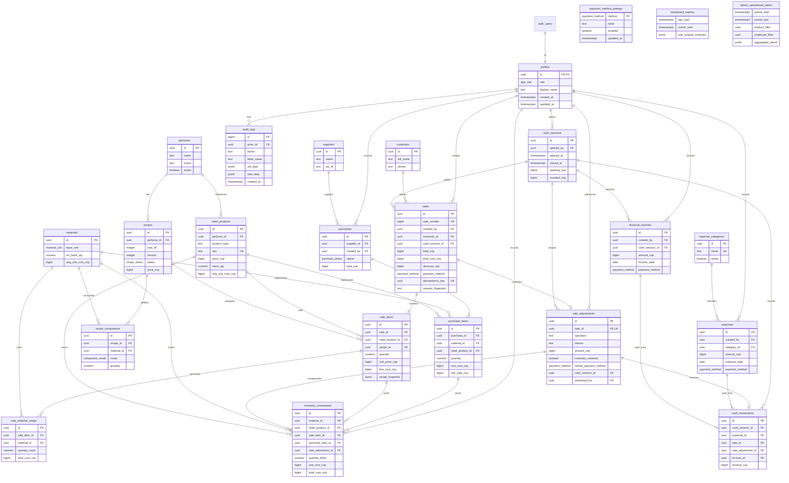

# Modelo entidad-relación — Perfumeria SC

Este documento describe el modelo relacional inicial de Supabase PostgreSQL.
Las cantidades son `NUMERIC`; los importes expresados en COP son enteros. Las
recetas guardan cantidades en la unidad base de cada material y nunca convierten
entre gramos y mililitros.

## Relaciones y reglas de dominio

- `profiles.id` referencia uno a uno `auth.users.id`; el rol no se toma de
  `user_metadata` ni puede ser autoseleccionado por un usuario.
- `perfumes` es el catálogo de fragancias. `retail_products` guarda las
  referencias terminadas originales y 1.1 vendidas por unidad; las recetas se
  asocian al perfume y a una presentación en ml.
- Una receta tiene versiones `draft`, `active` o `archived`; solo puede haber
  una versión activa por perfume y tamaño. Para modificar una receta activa se
  crea una versión borrador, se editan sus componentes y se activa mediante
  función transaccional.
- Un componente `fixed` tiene cantidad positiva en la unidad base del material.
  Como máximo un componente puede ser `fill_to_volume` por receta; debe usar
  material `ml` y su cantidad se calcula al vender como tamaño de la receta
  menos los componentes fijos que también usan `ml`. Una cantidad no positiva
  invalida la operación. No se convierte g a ml ni se infiere una receta.
- `materials` y `retail_products` conservan existencias y costo promedio
  ponderado en COP/unidad, con redondeo explícito a COP entero. Las entradas y
  salidas se registran en `inventory_movements`; no se permiten ajustes de
  inventario sin una función transaccional autorizada.
- Cada línea de venta referencia producto terminado **o** receta (exclusivo).
  Copia nombre, presentación, precio, costo y, cuando aplica, versión y
  componentes de receta. `sale_material_usage` conserva el consumo efectivo y
  el costo de cada material. Cambios futuros no alteran la venta histórica.
- `register_pos_sale` liga cada solicitud a una clave idempotente y una huella,
  bloquea existencias concurrentes y confirma encabezado, líneas, snapshots,
  consumo, movimientos y caja en una transacción. `sale_adjustments` conserva
  anulaciones/devoluciones totales y sus movimientos compensatorios; las ventas
  no se eliminan físicamente.
- `payment_method_settings` configura etiquetas y disponibilidad de los tipos
  definidos por `payment_method`; agregar un tipo requiere migrar el enum.
- El empleado puede consultar sus ventas y registrar ventas; sus permisos SQL
  no incluyen columnas de costos, márgenes ni utilidades. `recipe_components`,
  inventario operativo y ajustes de sus propias ventas son de solo lectura;
  costos, compras, gastos, configuración y auditoría quedan restringidos al
  administrador. El empleado solo puede consultar componentes de recetas
  activas.
- `purchases`/`purchase_items` se preparan como borrador y una función registra
  su recepción junto con existencias, promedio ponderado y movimientos en una
  sola transacción.
- Las tablas de caja vinculan sesiones con ventas de todos los métodos de pago,
  ingresos adicionales, gastos en efectivo, reversiones y movimientos. Solo el
  efectivo cambia el saldo esperado y el conteo físico. Los importes de ventas
  son ingresos, no utilidades; los costos y gastos siguen sin estar disponibles
  para el rol empleado.
- `expense_categories` clasifica egresos y conserva las categorías históricas
  mediante desactivación, no borrado. `financial_incomes` separa otros ingresos
  de las ventas; únicamente un ingreso en efectivo genera un movimiento que
  cambia el efectivo esperado.
- `admin_financial_report` resume ventas netas, costos históricos de venta,
  utilidad bruta, otros ingresos y gastos por período, exclusivamente para el
  administrador. Cada sesión abierta se limita a una por usuario mediante un
  índice único parcial; el modelo actual no identifica cajas físicas distintas.
- `dashboard_metrics` calcula resúmenes acotados del día y mes, alertas de stock
  y tendencias diarias. Para empleados restringe ventas a `auth.uid()` y omite
  costos/utilidad/gastos; `admin_operational_report` valida rol administrador y
  agrega los reportes filtrados en PostgreSQL. Las devoluciones se restan del
  ingreso de venta; para filtros de producto se atribuyen proporcionalmente a
  las líneas seleccionadas, sin alterar los registros transaccionales.

## Seguridad y auditoría

RLS se habilita en todas las tablas de `public`; `anon` no recibe permisos de
tabla. Las políticas consultan un helper no expuesto por PostgREST que deriva
el rol del perfil cuyo id es exactamente `auth.uid()`. Funciones
`SECURITY DEFINER` fijan `search_path`, validan usuario/rol internamente y solo
ejecutan la operación para el propio contexto autenticado. La aplicación no
usa ni almacena claves `service_role`.

Los movimientos de inventario y los registros de auditoría son append-only
para los clientes. Triggers registran cambios administrativos de catálogo,
recetas, compras, gastos, perfiles y caja, además de las operaciones
transaccionales. Solo el administrador puede consultar el log, que puede
contener instantáneas sensibles.

## Migraciones

Las migraciones ordenadas en `supabase/migrations/` son la fuente de verdad
ejecutable. La guía de ejecución y del primer administrador está en el
`README.md` raíz.
